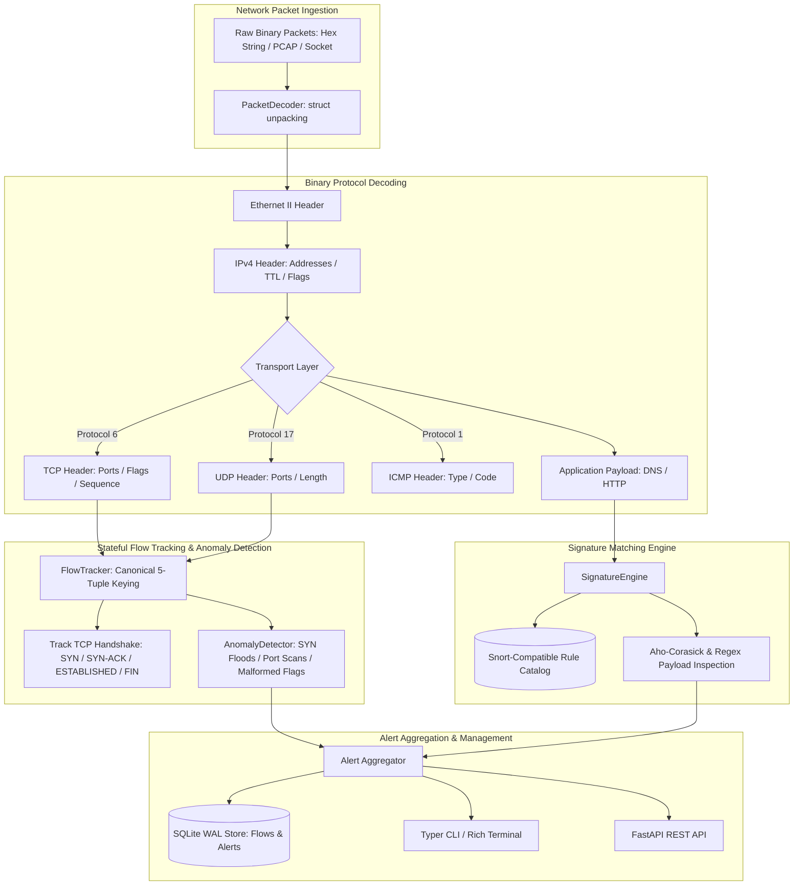

# Network Intrusion Detection System (`nids`)

High-Performance Pure-Python Network Intrusion Detection System featuring Binary Multi-Layer Packet Decoding, Stateful 5-Tuple Flow Tracking, Snort-Compatible Signatures, Heuristic Anomaly Detectors, SQLite WAL Storage, and FastAPI Control Plane.

[](https://github.com/Krish9800/network-intrusion-detection-system/actions)
[](https://opensource.org/licenses/MIT)
[](https://www.python.org/)
[](https://en.wikipedia.org/wiki/Stateful_firewall)
[](https://attack.mitre.org/)

---

## Overview & Problem Statement

Modern enterprise networks face diverse network-borne threats including port scanning, SYN flood denial-of-service, protocol misuse, and payload-based remote code execution exploits. Traditional heavy NIDS engines often require complex C-compilation toolchains and native library bindings, making them cumbersome for embedded environments, rapid deployment testing, or lightweight security microservices.

**Network Intrusion Detection System (`nids`)** is a pure-Python, zero-native-dependency network intrusion detection platform. It decodes raw binary network packets across Ethernet II, IPv4, TCP, UDP, ICMP, DNS, and HTTP layers. The system tracks stateful bi-directional 5-tuple flows, applies Snort-compatible signature pattern matching, detects heuristic protocol anomalies, and logs structured alerts with MITRE ATT&CK references into an ACID SQLite database.

---

## Architecture & Data Flow



---

## Verified Features & Capabilities

- **Zero-Dependency Binary Packet Decoding**: Pure-Python `struct` unpacking of Ethernet II, IPv4, TCP, UDP, ICMP, DNS, and HTTP headers without requiring `libpcap` or external C binaries.
- **Stateful 5-Tuple Flow Tracking**:
  - Maintains stateful bi-directional session tables keyed on canonical 5-tuples (`src_ip`, `dst_ip`, `src_port`, `dst_port`, `protocol`).
  - Tracks full TCP state machines (`SYN_SENT`, `SYN_RECV`, `ESTABLISHED`, `FIN_WAIT`, `CLOSED`).
  - Computes per-flow metrics: packet counts, byte volumes, duration, and session termination causes.
- **Snort-Compatible Signature Engine**:
  - Evaluates rule headers (protocol, directional ports, IP ranges) and rule options (`content`, `nocase`, `offset`, `depth`, `msg`, `sid`, `rev`).
  - Maps triggered signatures to MITRE ATT&CK technique identifiers.
- **Heuristic Protocol Anomaly Detection**:
  - Flags TCP flag anomalies (Xmas scan `FIN-PSH-URG`, NULL scan, SYN-FIN combinations).
  - Detects high-frequency port scanning and TCP SYN flood volume spikes.
- **ACID SQLite WAL Persistence**:
  - High-performance SQLite engine operating in Write-Ahead Logging (WAL) mode for storing flows and alerts.
- **Dual Interface**:
  - Command-line interface (`nids`) with Rich terminal formatting and packet inspection tools.
  - Asynchronous FastAPI REST control plane for remote management and telemetry queries.

---

## Technology Stack

- **Core Engine & CLI**: Python 3.12+, Typer, Rich, Pydantic v2
- **Network Decoding**: Python standard library `struct`, `binascii`, `socket`
- **Control Plane**: FastAPI, Uvicorn, Starlette
- **Persistence**: SQLite (WAL mode, busy timeout handling)
- **Quality & Assurance**: Pytest, Pytest-Asyncio, Ruff, Mypy (strict typing)
- **Containerization**: Rootless multi-stage Docker (`UID 10001`)

---

## CLI Reference & Operational Usage

The platform provides the `nids` command-line tool:

```bash
# 1. Analyze a raw hexadecimal packet string
nids analyze "00112233445566778899aabb08004500003c1c4640004006b1e6c0a80001c0a8000204d200500000000000000000a00272109e4d0000020405b40402080a000000000000000001030307"

# 2. Analyze a raw binary packet file from disk
nids analyze captured_packet.bin

# 3. List loaded detection signatures
nids rules list

# 4. List recorded intrusion alerts (with optional severity filter)
nids alerts list --severity HIGH

# 5. List tracked network flows (with optional state filter)
nids flows list --state ESTABLISHED

# 6. Launch the FastAPI control plane daemon
nids serve --host 127.0.0.1 --port 8000
```

---

## REST API Control Plane

Start the FastAPI daemon directly or via CLI:

```bash
uvicorn nids.api.app:app --host 127.0.0.1 --port 8000
```

Interactive OpenAPI documentation is available at `http://127.0.0.1:8000/docs`.

### Primary Endpoints

| Method | Endpoint | Description |
|:-------|:---------|:------------|
| `GET` | `/health` | Health telemetry and system statistics |
| `POST` | `/api/v1/packets/ingest` | Ingest raw hex or binary packet for real-time decoding and inspection |
| `GET` | `/api/v1/flows` | Query active and historical 5-tuple network sessions |
| `GET` | `/api/v1/alerts` | Query detected intrusion alerts with filtering options |
| `GET` | `/api/v1/rules` | List registered detection signatures |
| `POST` | `/api/v1/rules` | Dynamically register a new Snort-compatible detection rule |

---

## Installation & Setup

```bash
# Clone the repository
git clone https://github.com/Krish9800/network-intrusion-detection-system.git
cd network-intrusion-detection-system

# Create and activate virtual environment
python3 -m venv .venv
source .venv/bin/activate

# Install dependencies in editable mode
pip install --upgrade pip
pip install -e ".[dev]"
```

---

## Testing & Quality Assurance

Run the comprehensive unit, integration, and security test suite:

```bash
# Run pytest test suite
pytest

# Run tests with code coverage metrics
pytest --cov=nids --cov-report=term-missing

# Run code style and linting checks
ruff check .
ruff format --check .

# Run static type verification
mypy src/nids
```

---

## Security Model & Threat Boundaries

Documented in `docs/threat_model.md`:

- **Memory-Safe Protocol Parsing**: Handled in pure-Python `struct` decoding routines with rigorous bounds checking, eliminating buffer overflow and memory corruption vulnerabilities common in C-based packet decoders.
- **Resource Exhaustion Defense**: Flow table capacity is capped with stream-relative LRU time-to-live (TTL) eviction, mitigating flow table saturation attacks.
- **Unprivileged Execution**: Docker containers run as unprivileged user `UID 10001` with zero Linux capabilities (`cap_drop: ALL`).

---

## Limitations & Known Issues

- **High-Throughput Wire Speeds**: Pure-Python decoding is optimized for rapid inspection, testing, and traffic rates up to tens of megabits per second. For 10+ Gbps line-rate deployments, dedicated kernel-bypass frameworks (e.g. DPDK, AF_PACKET) are recommended.
- **IPv6 Support**: IPv6 decoding is planned for a future roadmap release; current decoding covers IPv4.

---

## License & Responsible Use

This project is licensed under the **MIT License** - see [LICENSE](https://opensource.org/licenses/MIT).

> [!NOTE]
> Designed for defensive security monitoring, network protocol analysis, and threat hunting. Ensure packet capture is conducted only on authorized networks.
